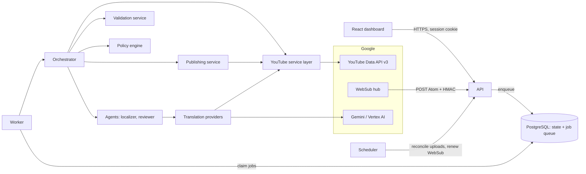
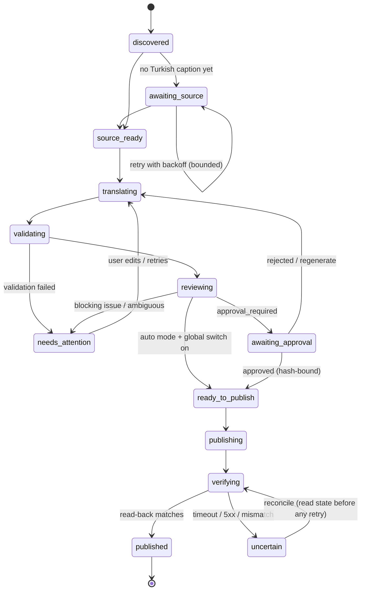
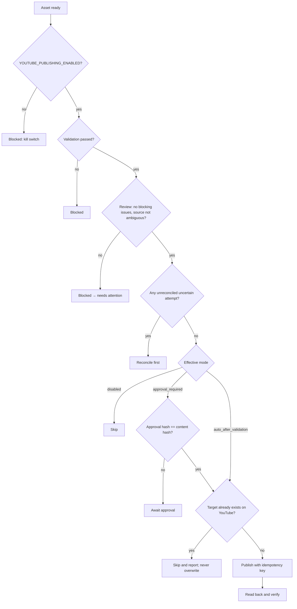

# Architecture

## 1. Shape: modular monolith

One Python codebase, one container image, two process roles:

- **api** — FastAPI: dashboard API, OAuth callback, WebSub webhook. Returns fast; never does heavy work inline.
- **worker** — executes durable jobs (discovery, translation, validation, publishing, reconciliation).

## 2. Layers and module boundaries

| Module | Responsibility | May call | Must never |
|---|---|---|---|
| `app/api` | HTTP, auth, input validation, enqueue | services (read), job queue | call YouTube write APIs directly |
| `app/orchestration` | Deterministic per-video state machine; decides next step; resumes | all services, agents | contain LLM prompts |
| `app/agents` | LLM tasks: metadata localization, quality review. Return Pydantic-validated JSON | translation providers | hold credentials, call YouTube, publish |
| `app/services/youtube` | **Only** module that talks to YouTube. Typed methods (`list_captions`, `download_caption`, `insert_caption`, `get_video`, `update_localizations`). Quota accounting. | Google API client | expose raw tokens |
| `app/services/translation` | Provider abstraction: `YouTubeNativeCaptionTranslator`, `GeminiTranslator`, `FakeTranslator` | youtube service, Gemini | publish |
| `app/services/captions` | SRT/VTT parse/serialize, cue alignment, choose provider per policy | translation | — |
| `app/services/validation` | Deterministic checks (timing, cue count, encoding, limits, language codes, existing tracks) | — | use an LLM |
| `app/services/policy` | Pure function: (policy, language, validation, review, approval, api state) → decision | — | perform I/O |
| `app/services/publishing` | Explicit write operations + post-write verification + reconciliation | youtube service | run without a `PublishDecision.allowed` |
| `app/services/monitoring` | WebSub verify/subscribe/renew; uploads-playlist reconciliation | youtube service, job queue | process videos inline |
| `app/tasks` | Job definitions, worker loop, retry/backoff | orchestration | — |
| `app/db`, `app/models` | SQLAlchemy async engine, ORM, Alembic | — | — |

**Why the orchestrator is not an LLM agent:** the workflow has fixed steps and
strict safety gates. A deterministic state machine is testable, resumable and
cannot be prompt-injected by video content. LLMs are used only where language
judgment is needed (translation, review) and their output is data, never commands.

## 3. Per-video / per-language state machine

Language assets are tracked separately for **metadata** (title+description) and
**captions**, because they are published by different API calls.

## 4. Core data model (Stage 2)

- `channel_connection` — channel id, channel title, custom url, uploads playlist id, encrypted refresh token, scopes, status (`connected`, `token_expired`, `revoked`, `error`).
- `video` — YouTube id, channel id, source title/description snapshot + hash, default language, privacy status (`public`, `private`, `unlisted`), scheduled `publish_at` (`status.publishAt` for scheduled videos), source caption availability state, workflow status (`discovered`, `awaiting_source`, `source_ready`, `processing`, `completed`, `needs_attention`, `failed`), discovered_at.
  - **Privacy & scheduling safeguard:** The system supports both immediately public videos and private/scheduled videos so localization can complete before `publish_at` when possible. **The application never modifies `status.privacyStatus` or `status.publishAt` under any circumstance.**
- `source_caption` — video id, YouTube caption track id, language (`tr`), `track_kind` (`standard`, `asr`, `forced`), `name`, `is_draft`, `is_auto_synced`, `processing_status` (`serving`, `syncing`, `failed`), `failure_reason`, `downloadable` diagnostic flag, `tlang_supported` diagnostic map, content hash, fetched_at.
  - **No assumptions on source tracks:** We record whether the Turkish track is uploaded (`standard`) or auto-generated (`asr`) and its processing status before attempting downloads or translations.
- `language_asset` — (video, language, kind=`metadata`|`caption`), explicit `state` (`pending`, `translating`, `validating`, `reviewing`, `needs_attention`, `awaiting_approval`, `ready_to_publish`, `publishing`, `verifying`, `uncertain`, `published`, `skipped`, `failed`), provider used, content, content hash, validation result, review result, prompt version, attempt_count, last_error.
- `approval` — asset id, **content hash**, approved_by, approved_at, invalidated_at. An edit changes the hash ⇒ approval no longer matches ⇒ invalid.
- `publish_attempt` — idempotency key, asset id, operation, request digest, response, outcome (`succeeded|failed|uncertain`), verified_at.
- `job` — type, payload, dedupe key (unique), explicit `state` (`queued`, `running`, `retry_scheduled`, `succeeded`, `dead_letter`, `cancelled`), attempts, max_attempts, next_run_at, locked_by/until, last_error.
- `quota_ledger` — date (Pacific time, YouTube's reset), method, units.
- `audit_event` — who/what/when for approvals, settings changes, publishes.

## 5. Background jobs (durable, resumable, idempotent)

Decision (see `docs/decisions.md`, ADR-002): **PostgreSQL-backed durable job table** in production (and SQLite table in local dev) as the source of truth — **never in-memory `BackgroundTasks`**.
- **Atomicity:** State transitions and job creation commit in the same database transaction.
- **Deduplication:** `dedupe_key` (e.g., `process_video:<video_id>`) has a database `UNIQUE` constraint. Duplicate WebSub notifications or playlist reconciliation scans resolve idempotently without creating duplicate jobs.
- **Claiming & Lease Recovery:** Workers claim ready jobs (`state IN ('queued', 'retry_scheduled') AND next_run_at <= NOW()`) or expired leases (`state = 'running' AND locked_until < NOW()`) using `SELECT … FOR UPDATE SKIP LOCKED` on PostgreSQL and an atomic conditional `UPDATE` fallback on SQLite.
- **Bounded Retries & Missing Captions:** Transient failures or missing/syncing source captions (`awaiting_source`) schedule a retry with exponential backoff (`next_run_at`) up to `max_attempts`, after which the job transitions to `dead_letter` (`needs_attention`) with a clear diagnostic error.
- **Production Execution:** Runs as a dedicated Cloud Run worker service (or Cloud Scheduler + Cloud Run job runner) backed by Cloud SQL PostgreSQL so jobs survive process restarts and continue when the developer's Mac is off.

## 6. Publishing safety

- Metadata writes: read current `snippet,localizations` → merge only the target
  language → write `part=localizations` → read back and diff. Never write `snippet`
  unless `defaultLanguage` is unset, and then only with explicit approval.
- Caption writes: check `captions.list` immediately before insert; `409 captionExists`
  is treated as "verify, don't retry".
- Uncertain outcomes (timeouts, 5xx after send) are reconciled by reading state
  before any retry.

## 7. Configuration precedence

1. Environment / Secret Manager — secrets, kill switch, infrastructure.
2. Database (dashboard edits, Stage 6) — per-language modes, enabled languages, audited.
3. `config/*.yaml` — defaults and seed values, validated at startup.

The global `auto_publish_enabled` flag starts `false`; enabling it is an audited action.

## 8. Deployment target (Stage 9)

- **Cloud Run**: `api` service (public, for dashboard + webhook) and `worker` service.
- **Cloud SQL for PostgreSQL** (smallest tier) with private IP / connector.
- **Secret Manager**: OAuth client, WebSub secret, Gemini key (or none with Vertex AI).
- **Cloud KMS**: envelope encryption of refresh tokens.
- **Cloud Scheduler**: reconcile uploads (e.g. every 15 min), renew WebSub (daily), run jobs.
- **Identity-Aware Proxy** or app-level Google Sign-In with allowlist for the dashboard.
- **Cloud Logging / Monitoring**: structured logs, alerting on failed/uncertain publishes and quota.

## 9. Main technical risks

| Risk | Impact | Mitigation |
|---|---|---|
| `tlang` unavailable/unreliable (esp. ASR tracks) | Native route unusable for some videos | PoC first; LLM fallback behind provider abstraction; per-language provider record |
| API translation ≠ Studio Auto-translate | Different quality/behavior than expected | Creator compares in PoC (A5); dashboard review |
| `videos.update` part replacement wipes metadata | Data loss on the channel | Read-merge-write of `localizations` only, read-back diff, contract tests |
| Quota exhaustion (~5k units/video) | Delays | Quota ledger, scheduling, fallback to LLM saves 1,600 units, request quota increase |
| OAuth token expiry (Testing mode = 7 days) or revocation | Silent stop | Publish OAuth app "In production"; health check + dashboard alert |
| WebSub misses private/scheduled uploads | Late detection | Periodic authenticated reconciliation of uploads playlist |
| Spoofed webhook calls | Junk jobs / quota burn | HMAC signature (`hub.secret`), channel-id check, then confirm via authenticated API |
| LLM alters meaning, URLs, names, numbers | Wrong public content | Deterministic placeholder protection for URLs/hashtags/numbers, reviewer agent, human approval by default |
| Prompt injection via video description/subtitles | Manipulated output | LLM has no tools; output schema-validated; publishing gated by deterministic policy |
| Uncertain API outcome then retry ⇒ duplicate track | Duplicate captions | Idempotency keys, reconcile-before-retry, `409` handling |
| Concurrent edits in Studio during our write | Overwrite her change | Re-read right before write; abort on unexpected diffs |
| RTL (Arabic) subtitle rendering/editing | Broken display | RTL-aware editor, byte-level validation |

