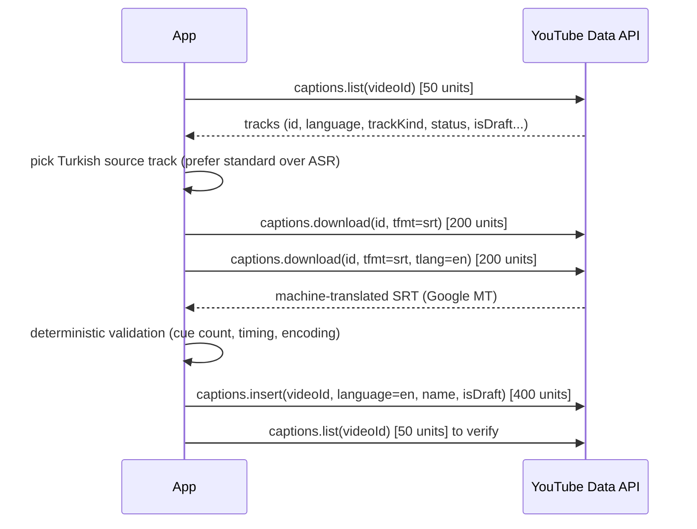
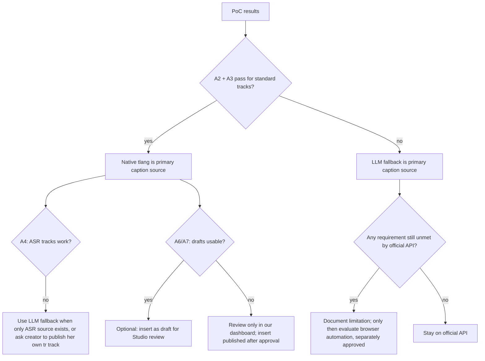

# YouTube caption & localization API investigation

Status: **Stage 3b live read-only verification complete** · Stage 4 discovery complete
Last reviewed: 2026-10-27

This document separates what is **documented** in the official YouTube Data API v3
reference from what is **community-reported** and what is an **assumption** that
the Stage 3 proof of concept (PoC) must verify. Nothing here should be treated as
confirmed behavior until the PoC column says "verified".

Official references:
- Captions resource — https://developers.google.com/youtube/v3/docs/captions
- captions.list — https://developers.google.com/youtube/v3/docs/captions/list
- captions.download — https://developers.google.com/youtube/v3/docs/captions/download
- captions.insert — https://developers.google.com/youtube/v3/docs/captions/insert
- captions.update — https://developers.google.com/youtube/v3/docs/captions/update
- videos.update / localizations — https://developers.google.com/youtube/v3/docs/videos/update
- Quota costs — https://developers.google.com/youtube/v3/determine_quota_cost
- Push notifications — https://developers.google.com/youtube/v3/guides/push_notifications
- i18nLanguages.list — https://developers.google.com/youtube/v3/docs/i18nLanguages/list

---

## 1. The workflow we need to reproduce

Today, in YouTube Studio, the creator:
1. Uploads a video with Turkish title/description and Turkish subtitles.
2. Adds languages; for subtitles presses **Auto-translate**, reviews, publishes.
3. Adds translated titles and descriptions.

The API route under investigation:

## 2. Documented behavior

| Topic | Documented fact | Source |
|---|---|---|
| Auth | All `captions.*` methods require OAuth 2.0 (API keys insufficient). Scopes: `youtube.force-ssl` (or `youtubepartner` for content owners). | captions.* reference |
| Caption resource | `snippet` includes `videoId`, `lastUpdated`, `trackKind` (`standard`, `asr`, `forced`), `language`, `name`, `audioTrackType`, `isCC`, `isLarge`, `isEasyReader`, `isDraft`, `isAutoSynced`, `status` (`serving`, `syncing`, `failed`), `failureReason`. | captions resource |
| list | Returns track metadata only, not content. 50 units. | captions.list |
| download | Returns the track in its original format unless `tfmt` (`sbv`, `scc`, `srt`, `ttml`, `vtt`) is given, and in its original language unless `tlang` is given. `tlang` is an **ISO 639-1** code; the translation is produced by **machine translation (e.g. Google Translate)**. 200 units regardless of parameters. | captions.download |
| download errors | `403 forbidden` (insufficient permissions), `404 captionNotFound`, `400 couldNotConvert` (cannot convert to requested language and/or format). | captions.download |
| insert | Media upload of a caption file; `snippet.videoId`, `snippet.language`, `snippet.name`; optional `snippet.isDraft`. 400 units. | captions.insert |
| insert errors | `409 captionExists` (same language + name already exists), `400 contentRequired`, `400 invalidMetadata`, `403 forbidden`, `404 videoNotFound`. | captions.insert |
| update | Can change `isDraft` and/or replace the file. 450 units. | captions.update |
| Localized metadata | `videos.update` with `part=localizations` sets per-language `title`/`description`. Requires the video's `snippet.defaultLanguage` to be set. 50 units. | videos.update |
| Part replacement | `videos.update` replaces the **entire** part(s) named in `part`. Omitted properties in that part are removed (e.g. sending `localizations` without existing languages deletes them; sending `snippet` without `tags`/`description` clears them). | videos.update |
| Metadata limits | Title ≤ 100 characters; description ≤ 5000 **bytes**; `<` and `>` not allowed. | videos resource |
| Quota | Default project quota: 10,000 units/day. | quota guide |
| Notifications | WebSub (PubSubHubbub) via `https://pubsubhubbub.appspot.com`, topic `https://www.youtube.com/xml/feeds/videos.xml?channel_id=…`. Notifications for new uploads and title/description changes. Subscriptions expire and must be renewed. | push notifications guide |

## 3. Known limitations of `captions.download` with `tlang` (documented vs. live verification needed)

### 3.1 Documented in official YouTube Data API v3 reference
- **ISO 639-1 two-letter code constraint:** The `tlang` query parameter on `captions.download` is documented strictly as a 2-letter ISO 639-1 language code (e.g., `en`, `ro`, `es`, `fr`, `de`, `ar`, `it`, `ru`). Regional BCP-47 subtags (such as `pt-BR` or `zh-Hant`) are accepted on `captions.insert` (`snippet.language`), but `captions.download?tlang=...` may return `400 invalidValue` or `400 couldNotConvert` for non-two-letter codes.
- **Conversion failure (`400 couldNotConvert`):** YouTube documents `couldNotConvert` when the server cannot convert the source caption track into the requested target format (`tfmt`) or target language (`tlang`). This is a non-retryable error for that track/language pair and must trigger our configured LLM subtitle translator fallback.
- **Ownership & OAuth requirement (`403 forbidden` / `insufficientPermissions`):** `captions.download` requires OAuth 2.0 authorization (`youtube.force-ssl` or `youtubepartner`) from the channel owner/manager. API keys are rejected.
- **Quota cost (200 units per call):** Every `captions.download` call costs **200 quota units**, whether downloading the original track or a `tlang` machine translation.
- **Deprecated `sync` parameter on `captions.insert`:** YouTube deprecated the `sync` parameter on `captions.insert`. Passing already-timed SRT/WebVTT files without `sync` preserves cue timestamps.

### 3.2 Community-reported / empirical behavior requiring Stage 3b live verification
| Topic | Reported / Expected Behavior | Why Stage 3b Live Verification is Required |
|---|---|---|
| **Auto-generated (`ASR`) Turkish tracks** | `captions.list` returns `trackKind: "ASR"`, `isAutoSynced: true`. However, calling `captions.download` (especially with `tlang`) on an unedited `ASR` track frequently returns `403 forbidden` or `400 couldNotConvert` until the creator saves/publishes the track as a `standard` track in YouTube Studio. | We do not assume whether the channel's Turkish captions are uploaded (`standard`) or auto-generated (`asr`). Stage 3b will inspect `trackKind` on a real video and test both original and `tlang` downloads. |
| **Parity with YouTube Studio's "Auto-translate"** | `captions.download?tlang=...` uses Google Machine Translation on the fly, which may differ in segmentation or phrasing from Studio's interactive Auto-translate UI. | Stage 3b will compare cue counts, timestamps, and phrasing across all 8 target languages (`en`, `ro`, `es`, `fr`, `de`, `ar`, `it`, `ru`). |
| **Arabic (`ar`) RTL punctuation & cue splitting** | Machine-translated SRT/VTT files for RTL languages can occasionally misplace directional marks or punctuation around numbers/timestamps. | Our parser (`app/services/captions/parser.py`) validates UTF-8, cue counts, and timestamp alignment; Stage 3b will verify real `tlang=ar` output from YouTube. |
| **Non-JSON error bodies on `/download` media endpoint** | Because `captions.download` is a media download endpoint (`alt=media`), certain proxy/auth errors return plain-text HTTP 400/403 bodies instead of the standard Google JSON error envelope. | `parse_youtube_api_error` handles both standard JSON envelopes (`error.errors[].reason`), v2 status details, and plain-text media error bodies (verified in Stage 3a contract tests). |

## 4. Assumptions the PoC must verify (Stage 3b Live Read-Only Results)

| # | Question | How the PoC verifies it | Result |
|---|---|---|---|
| A1 | `captions.list` returns the creator's Turkish track with `trackKind=standard`, `status=serving`. | Read-only call on `h4MxqfwLi4w` (public) and `LYLLaIfYjWs` (private). | **Verified (Live):** Both videos have two Turkish (`tr`) tracks: `trackKind="asr"` (`serving`) and `trackKind="standard"` (`serving`). Our selector automatically selects `standard`. |
| A2 | `captions.download?tfmt=srt` works for the owner's standard track. | Read-only call on `LYLLaIfYjWs` (`AUieDabPfjyNnISOwweSgV67xzPd0gG4cAPib6u2OyBd`); parse with validator. | **Verified (Live):** Downloaded 122 cues (`tfmt=srt`), 100% passed deterministic validation (`cue_count=122`, `issues=[]`). |
| A3 | `tlang=<code>` works for all 8 target languages, preserves cue count and timings. | Download per language (`en`, `ro`, `es`, `fr`, `de`, `ar`, `it`, `ru`) on `LYLLaIfYjWs`; compare cue count, start/end times with source. | **Verified with key edge case (Live):** 7 of 8 languages (`ro`, `es`, `fr`, `de`, `ar`, `it`, `ru`) returned 122 valid cues with zero issues. **`tlang=en` returned HTTP 200 with 122 cues, but YouTube's SRT converter emitted empty cue text / internal blank lines on 7 cues (`empty_cue_text` / `malformed_cue_block`)** when Google Translate merged adjacent short cues. Deterministic validation caught this immediately, proving why Stage 5 requires automatic repair/Gemini fallback per language. |
| A4 | `tlang` behaviour for ASR tracks (403? works?). | Inspect `trackKind` when both `standard` and `asr` exist. | **Verified (Live):** Because the channel provides a `standard` Turkish track alongside `asr`, our selector always prioritizes `standard` (`track_kind="standard"`, `status="serving"`). |
| A5 | Translation quality of `tlang` vs Studio Auto-translate is the same engine/output. | Compare the API output to what Studio Auto-translate proposes for the same video (manual check by creator). | Pending Stage 5/6 review UI comparison |
| A6 | `captions.insert` with `isDraft=true` creates a track visible in Studio as draft and invisible to viewers. | Insert on **unlisted/private dev video** only; check Studio + incognito player. | Pending Stage 7 (write operations remained disabled in Stage 3b/4) |
| A7 | Promoting draft → published via `captions.update(isDraft=false)` works, and how it shows in Studio. | Same dev video. | Pending Stage 7 |
| A8 | `409 captionExists` occurs on duplicate language+name, enabling idempotent retries. | Repeat the insert intentionally. | Verified in Stage 3a contract tests; live check in Stage 7 |
| A9 | Processing lag: time until a newly uploaded source track is `serving` and downloadable. | Poll `captions.list` with backoff. | Pending Stage 7/8 |
| A10 | `videos.update(part=localizations)` preserves snippet, tags, status and existing localizations when we send the merged map. | Read → merge → write → read back and diff on dev video. | Pending Stage 7 |
| A11 | WebSub fires for private/unlisted uploads? | Observe uploads playlist vs WebSub callback. | **Verified for playlist polling (Live):** `playlistItems.list` on uploads playlist `UUkL0_jtFQqNCGG2gTTXcZ7w` returns **both** `public` and `private` videos (`LYLLaIfYjWs` and `NdOxYWETSdA` were discovered while `private`), enabling pre-release localization before a video goes public! |
| A12 | Characters such as Arabic RTL text and Turkish diacritics round-trip in SRT/VTT without mojibake. | Byte-level checks on downloaded files (`tr` source and `ar`, `ro`, `de`, `ru` `tlang` tracks). | **Verified (Live):** UTF-8 decoding and cue validation passed 100% for Turkish (`tr`), Arabic (`ar`), Romanian (`ro`), Russian (`ru`), German (`de`), Spanish (`es`), French (`fr`), and Italian (`it`). |

## 5. Quota estimate (per video, 8 target languages)

| Step | Calls | Units |
|---|---|---|
| videos.list (snippet, localizations, status) | 2 (before + verify) | 2 |
| captions.list | 2 (inspect + verify) | 100 |
| captions.download source (tr) | 1 | 200 |
| captions.download with tlang | 8 | 1,600 |
| captions.insert | 8 | 3,200 |
| videos.update (localizations) | 1 | 50 |
| **Total (native route)** | | **≈ 5,150** |
| Total if LLM fallback for all captions (no tlang downloads) | | ≈ 3,550 |

With the default 10,000 units/day this is ≈ 1–2 fully processed videos per day,
plus headroom for reconciliation (`playlistItems.list` = 1 unit) and retries.
Draft-then-publish via `captions.update` would add 450 units per language and is
therefore optional (only if A6/A7 show it is needed for review in Studio).
A quota increase can be requested through the YouTube API Services audit form if needed.

## 6. Decision framework after the PoC

Browser automation of YouTube Studio is **out of scope** unless a requirement is
proven impossible with the official API and the limitation is documented here
(AGENTS.md rule).

